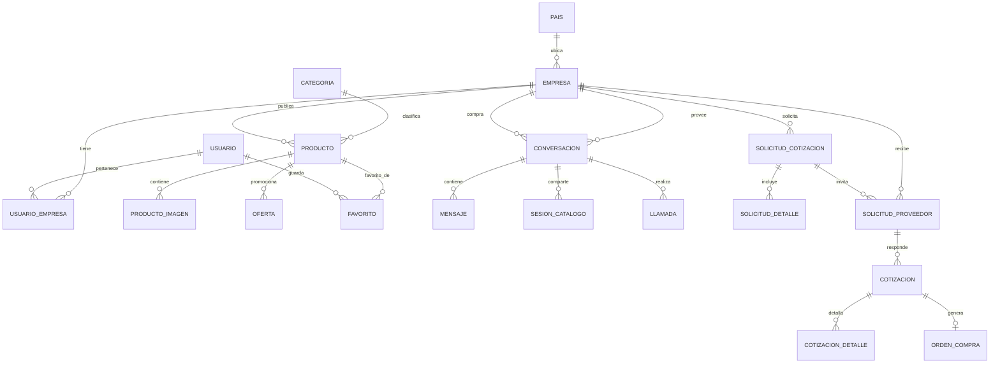

# ProveeNet — Red Internacional de Proveedores B2B

> **Documento de especificación funcional y técnica · Versión 1.0 · Noviembre de 2026**  
> Estado: propuesta de arquitectura; no representa un sistema implementado.

## 1. Resumen ejecutivo

**ProveeNet** es una plataforma comercial B2B para conectar empresas compradoras y proveedoras locales, nacionales e internacionales. Cada empresa dispone de un perfil y de usuarios autorizados. Los proveedores publican productos, instrumentos y ofertas; los compradores exploran catálogos, guardan favoritos, siguen empresas, chatean con ellas y solicitan cotizaciones. La plataforma incorpora llamadas, videollamadas y sesiones voluntarias de catálogo compartido en tiempo real para negociar productos dentro de la misma conversación.

**Principio de diseño:** la conversación comercial pertenece a las **empresas**; los mensajes identifican a los **usuarios** que actúan en representación de ellas. Un cambio de ejecutivo no elimina el historial empresarial.

## 2. Objetivos

### Objetivo general
Desarrollar una red comercial digital segura y multiempresa para descubrir proveedores, presentar productos y gestionar relaciones comerciales y cotizaciones internacionales.

### Objetivos específicos
- Centralizar perfiles verificados de proveedores y compradores.
- Publicar productos con precios y monedas, fichas técnicas y ofertas.
- Facilitar búsquedas por país, categoría, marca y disponibilidad.
- Mantener favoritos y seguimiento de proveedores.
- Ofrecer mensajería directa entre empresas con archivos y tarjetas de productos.
- Habilitar llamadas y videollamadas dentro de la plataforma.
- Sincronizar voluntariamente la visualización de catálogos durante una negociación.
- Solicitar cotizaciones a uno o varios proveedores y conservar sus versiones.
- Generar órdenes de compra a partir de ofertas aceptadas.
- Registrar eventos, notificaciones y auditoría.

## 3. Alcance y actores

| Actor | Capacidades principales |
|---|---|
| Visitante | Explorar contenido público según las reglas de visibilidad. |
| Comprador individual | Guardar favoritos y contactar proveedores; el modelo debe contemplar conversaciones individuales en una ampliación. |
| Usuario de empresa compradora | Consultar catálogos, conversar, invitar proveedores y evaluar cotizaciones. |
| Ejecutivo proveedor | Gestionar productos autorizados, responder mensajes y enviar cotizaciones. |
| Administrador de empresa | Gestionar miembros, permisos, perfil empresarial y operaciones. |
| Administrador de plataforma | Verificar empresas, moderar publicaciones y administrar incidencias. |

Una misma empresa puede ser **compradora y proveedora**. Un usuario puede pertenecer a varias empresas y tener un rol distinto en cada una. Las acciones deben ejecutarse dentro de un contexto de empresa activa.

## 4. Módulos funcionales

1. **Identidad y acceso:** registro, inicio/cierre de sesión, recuperación de contraseña, roles, invitaciones y control de acceso por empresa.
2. **Empresas internacionales:** datos legales, identificación fiscal según país, país/ciudad, perfiles, contactos y verificación.
3. **Catálogo:** categorías jerárquicas, productos, fotografías, fichas técnicas, SKU, stock, precios de referencia y monedas ISO 4217.
4. **Ofertas:** promociones con fecha de inicio, término, estado y precio promocional.
5. **Red comercial:** favoritos, seguimiento de empresas y publicaciones de novedades.
6. **Mensajería:** bandeja de conversaciones empresariales, participantes, mensajes, adjuntos, lectura y tarjetas de productos.
7. **Catálogo compartido:** sesión consensuada para mostrar el mismo producto a participantes autorizados en tiempo real.
8. **Llamadas:** invitación, aceptación/rechazo, voz, video, participantes, controles de micrófono/cámara y finalización.
9. **Cotizaciones RFQ:** solicitud multítem, invitación a varios proveedores, respuestas, versiones, negociación, aceptación y rechazo.
10. **Órdenes de compra:** creación desde cotización aceptada, seguimiento y trazabilidad.
11. **Notificaciones y auditoría:** avisos, historial de estados y eventos críticos.

## 5. Experiencia de usuario

### 5.1 Comprador
1. Inicia sesión y selecciona la empresa que representa.
2. Busca proveedores, filtra por país y revisa sus productos.
3. Guarda un producto como favorito y sigue al proveedor.
4. Abre **Contactar proveedor** desde el perfil o la ficha de producto.
5. Escribe a la empresa; un ejecutivo autorizado responde desde la bandeja empresarial.
6. Abre la pestaña **Catálogo** y comparte un producto en el chat.
7. Puede aceptar una invitación a **catálogo compartido**, llamada o videollamada.
8. Solicita una cotización formal y compara respuestas.
9. Acepta una oferta y genera una orden de compra.

### 5.2 Proveedor
1. Registra su empresa, solicita verificación y administra sus miembros.
2. Publica productos y promociones.
3. Atiende conversaciones en nombre de la empresa.
4. Envía tarjetas de productos y propone una sesión de catálogo compartido.
5. Inicia o acepta llamadas/videollamadas.
6. Responde RFQ con cantidades, moneda, precios, plazos, garantías y documentos.
7. Consulta el historial comercial y el estado de las operaciones.

### 5.3 Conversación y catálogo en tiempo real
- La cabecera de la conversación presenta **Chat | Catálogo | Cotización | Llamada | Videollamada | Archivos**.
- Abrir **Catálogo** normalmente muestra el catálogo al usuario que hizo clic: **no comparte automáticamente su navegación**.
- Al pulsar **Iniciar sesión compartida**, se solicita consentimiento a la contraparte.
- Con consentimiento, el producto activo, la fotografía seleccionada y la ficha técnica se sincronizan mediante eventos de WebSocket.
- Cualquier participante puede salir de la sesión sin cerrar el chat.
- Se conserva una referencia de los productos compartidos, pero no se registra indiscriminadamente toda la navegación privada.
- La llamada o videollamada puede coexistir con el chat y el catálogo; su grabación está deshabilitada por defecto y requeriría consentimiento y políticas específicas.

## 6. Arquitectura tecnológica recomendada

```text
[Web responsive: Next.js + Tailwind CSS]
                |
        HTTPS / REST API
                |
[Django + Django REST Framework] ---- [PostgreSQL]
                |
       [Django Channels]
                |
        [Redis / WebSockets]
                |
      Señalización WebRTC
                |
[Clientes WebRTC] --- [STUN / TURN]

[Almacenamiento compatible con S3] <- imágenes, fichas y archivos
[Trabajos asíncronos / Celery]      <- correos, alertas, PDF
```

- **Backend:** Django y Django REST Framework.
- **Frontend:** Next.js, TypeScript y Tailwind CSS (alternativa: plantillas Django).
- **Base de datos:** PostgreSQL.
- **Chat y sincronización:** Django Channels, Redis y WebSockets.
- **Voz y video:** WebRTC, servidor de señalización y STUN/TURN; para llamadas grupales de mayor escala considerar una SFU.
- **Archivos:** almacenamiento de objetos con URLs firmadas y validación de tipos/tamaños.
- **Despliegue:** HTTPS obligatorio, variables de entorno y observabilidad.

## 7. Modelo de datos: convenciones

- Se usan nombres de tabla en singular y `snake_case`.
- `BIGINT` para claves; `NUMERIC(18,2)` para dinero; `TIMESTAMPTZ` para instantes.
- Todas las FK requieren índices adecuados y reglas explícitas de borrado.
- `creado_en` y `actualizado_en` se recomiendan en tablas operativas aunque no se repitan en cada listado.
- Las contraseñas se guardan **solo como hashes seguros**, preferiblemente Argon2id, nunca en texto plano.
- Las referencias de moneda se almacenan como códigos ISO 4217, y los precios históricos se preservan.
- Los valores de estado pueden implementarse con `CHECK`, enumeraciones controladas o tablas de catálogo.
- Las imágenes y adjuntos se guardan en almacenamiento externo; la base conserva sus metadatos y rutas.

## 8. Diccionario de datos completo

### 8.1 Identidad y empresas

**`pais`**: `id_pais BIGINT PK`, `codigo_iso CHAR(2) UNIQUE NOT NULL`, `nombre VARCHAR(120) NOT NULL`.

**`usuario`**: `id_usuario BIGINT PK`, `nombre VARCHAR(100) NOT NULL`, `apellido VARCHAR(100)`, `email VARCHAR(254) UNIQUE NOT NULL`, `password_hash VARCHAR(255) NOT NULL`, `activo BOOLEAN NOT NULL DEFAULT TRUE`, `fecha_registro TIMESTAMPTZ NOT NULL`.

**`empresa`**: `id_empresa BIGINT PK`, `id_pais BIGINT FK pais NOT NULL`, `razon_social VARCHAR(180) NOT NULL`, `nombre_comercial VARCHAR(180)`, `identificacion_fiscal VARCHAR(80)`, `ciudad VARCHAR(120)`, `direccion VARCHAR(255)`, `descripcion TEXT`, `logo_url TEXT`, `sitio_web TEXT`, `es_proveedor BOOLEAN NOT NULL DEFAULT FALSE`, `es_comprador BOOLEAN NOT NULL DEFAULT TRUE`, `verificada BOOLEAN NOT NULL DEFAULT FALSE`, `estado VARCHAR(24) NOT NULL`.

**`usuario_empresa`**: `id_usuario_empresa BIGINT PK`, `id_usuario BIGINT FK usuario NOT NULL`, `id_empresa BIGINT FK empresa NOT NULL`, `rol VARCHAR(32) NOT NULL`, `activo BOOLEAN NOT NULL DEFAULT TRUE`, `UNIQUE(id_usuario,id_empresa)`.

> La identificación fiscal no es universal: su formato y obligatoriedad dependen del país. Para proveedores locales, nacionales o internacionales, se determina la clasificación **respecto de la empresa compradora** y su país/región, no mediante un único campo fijo en el proveedor.

### 8.2 Catálogo y promociones

**`categoria`**: `id_categoria BIGINT PK`, `id_categoria_padre BIGINT FK categoria NULL`, `nombre VARCHAR(120) NOT NULL`, `slug VARCHAR(150) UNIQUE NOT NULL`, `activa BOOLEAN NOT NULL DEFAULT TRUE`.

**`producto`**: `id_producto BIGINT PK`, `id_empresa BIGINT FK empresa NOT NULL`, `id_categoria BIGINT FK categoria NOT NULL`, `nombre VARCHAR(180) NOT NULL`, `sku VARCHAR(80) NOT NULL`, `marca VARCHAR(120)`, `modelo VARCHAR(120)`, `descripcion TEXT`, `precio_referencia NUMERIC(18,2) NULL`, `moneda CHAR(3)`, `stock INTEGER NULL`, `requiere_cotizacion BOOLEAN NOT NULL DEFAULT TRUE`, `activo BOOLEAN NOT NULL DEFAULT TRUE`, `fecha_publicacion TIMESTAMPTZ NOT NULL`, `UNIQUE(id_empresa,sku)`; comprobar `stock >= 0` cuando no sea nulo y que precio/moneda se informen conjuntamente.

**`producto_imagen`**: `id_imagen BIGINT PK`, `id_producto BIGINT FK producto NOT NULL`, `archivo_url TEXT NOT NULL`, `texto_alternativo VARCHAR(255)`, `orden INTEGER NOT NULL DEFAULT 0`, `es_portada BOOLEAN NOT NULL DEFAULT FALSE`.

**`oferta`**: `id_oferta BIGINT PK`, `id_producto BIGINT FK producto NOT NULL`, `titulo VARCHAR(180) NOT NULL`, `precio_oferta NUMERIC(18,2) NOT NULL`, `moneda CHAR(3) NOT NULL`, `fecha_inicio TIMESTAMPTZ NOT NULL`, `fecha_fin TIMESTAMPTZ NOT NULL`, `activa BOOLEAN NOT NULL DEFAULT TRUE`; comprobar `fecha_fin > fecha_inicio` y precio no negativo. Definir política para ofertas vigentes superpuestas.

### 8.3 Red comercial

**`favorito`**: `id_favorito BIGINT PK`, `id_usuario BIGINT FK usuario NOT NULL`, `id_producto BIGINT FK producto NOT NULL`, `fecha_creacion TIMESTAMPTZ NOT NULL`, `UNIQUE(id_usuario,id_producto)`.

**`seguimiento_proveedor`**: `id_seguimiento BIGINT PK`, `id_usuario BIGINT FK usuario NOT NULL`, `id_empresa BIGINT FK empresa NOT NULL`, `fecha_seguimiento TIMESTAMPTZ NOT NULL`, `UNIQUE(id_usuario,id_empresa)`.

**`publicacion`**: `id_publicacion BIGINT PK`, `id_empresa BIGINT FK empresa NOT NULL`, `id_usuario_autor BIGINT FK usuario NOT NULL`, `titulo VARCHAR(180)`, `contenido TEXT NOT NULL`, `visibilidad VARCHAR(24) NOT NULL`, `estado VARCHAR(24) NOT NULL`, `fecha_publicacion TIMESTAMPTZ NOT NULL`.

### 8.4 Conversaciones y mensajes

**`conversacion`**: `id_conversacion BIGINT PK`, `id_empresa_compradora BIGINT FK empresa NOT NULL`, `id_empresa_proveedora BIGINT FK empresa NOT NULL`, `id_producto_contexto BIGINT FK producto NULL`, `estado VARCHAR(24) NOT NULL`, `fecha_creacion TIMESTAMPTZ NOT NULL`, `CHECK(id_empresa_compradora <> id_empresa_proveedora)`.

**`participante_conversacion`**: `id_participante BIGINT PK`, `id_conversacion BIGINT FK conversacion NOT NULL`, `id_usuario BIGINT FK usuario NOT NULL`, `ultima_lectura TIMESTAMPTZ`, `fecha_ingreso TIMESTAMPTZ NOT NULL`, `UNIQUE(id_conversacion,id_usuario)`.

**`mensaje`**: `id_mensaje BIGINT PK`, `id_conversacion BIGINT FK conversacion NOT NULL`, `id_usuario_remitente BIGINT FK usuario NOT NULL`, `id_empresa_remitente BIGINT FK empresa NOT NULL`, `tipo VARCHAR(24) NOT NULL`, `contenido TEXT`, `archivo_url TEXT NULL`, `fecha_envio TIMESTAMPTZ NOT NULL`, `fecha_edicion TIMESTAMPTZ NULL`, `eliminado_en TIMESTAMPTZ NULL`.

**`producto_compartido`**: `id_producto_compartido BIGINT PK`, `id_conversacion BIGINT FK conversacion NOT NULL`, `id_mensaje BIGINT FK mensaje NULL`, `id_producto BIGINT FK producto NOT NULL`, `id_usuario BIGINT FK usuario NOT NULL`, `fecha_compartido TIMESTAMPTZ NOT NULL`.

**`evento_conversacion`**: `id_evento BIGINT PK`, `id_conversacion BIGINT FK conversacion NOT NULL`, `id_usuario BIGINT FK usuario NULL`, `tipo_evento VARCHAR(40) NOT NULL`, `datos JSONB`, `fecha_evento TIMESTAMPTZ NOT NULL`.

> **Autorización esencial:** antes de publicar o leer un mensaje, comprobar que el usuario pertenece y está habilitado en una de las empresas de la conversación, y que su participación o política de acceso permite la operación. La FK por sí sola no garantiza este control.

### 8.5 Catálogo compartido

**`sesion_catalogo`**: `id_sesion BIGINT PK`, `id_conversacion BIGINT FK conversacion NOT NULL`, `id_usuario_iniciador BIGINT FK usuario NOT NULL`, `id_producto_actual BIGINT FK producto NULL`, `estado VARCHAR(24) NOT NULL`, `fecha_inicio TIMESTAMPTZ`, `fecha_fin TIMESTAMPTZ NULL`.

**`participante_sesion_catalogo`**: `id_participante_sesion BIGINT PK`, `id_sesion BIGINT FK sesion_catalogo NOT NULL`, `id_usuario BIGINT FK usuario NOT NULL`, `consentimiento BOOLEAN NOT NULL DEFAULT FALSE`, `fecha_union TIMESTAMPTZ NULL`, `fecha_salida TIMESTAMPTZ NULL`, `UNIQUE(id_sesion,id_usuario)`.

**`evento_catalogo`**: `id_evento_catalogo BIGINT PK`, `id_sesion BIGINT FK sesion_catalogo NOT NULL`, `id_usuario BIGINT FK usuario NOT NULL`, `id_producto BIGINT FK producto NULL`, `tipo_evento VARCHAR(32) NOT NULL`, `fecha_evento TIMESTAMPTZ NOT NULL`.

Los cambios de producto se emiten por WebSocket únicamente a participantes consentidos de una sesión activa. Se deben validar los permisos sobre el producto antes de compartirlo.

### 8.6 Voz y videollamadas

**`llamada`**: `id_llamada BIGINT PK`, `id_conversacion BIGINT FK conversacion NOT NULL`, `id_usuario_iniciador BIGINT FK usuario NOT NULL`, `tipo VARCHAR(12) NOT NULL` (`voz`/`video`), `estado VARCHAR(24) NOT NULL`, `fecha_invitacion TIMESTAMPTZ NOT NULL`, `fecha_inicio TIMESTAMPTZ NULL`, `fecha_fin TIMESTAMPTZ NULL`.

**`participante_llamada`**: `id_participante_llamada BIGINT PK`, `id_llamada BIGINT FK llamada NOT NULL`, `id_usuario BIGINT FK usuario NOT NULL`, `estado VARCHAR(24) NOT NULL`, `fecha_union TIMESTAMPTZ NULL`, `fecha_salida TIMESTAMPTZ NULL`, `UNIQUE(id_llamada,id_usuario)`.

La señalización WebRTC usa eventos temporales y credenciales efímeras; **no** es necesario persistir los paquetes de audio/video ni las ofertas SDP completas. Registrar solo metadatos operativos necesarios. Las grabaciones no forman parte del MVP.

### 8.7 Solicitudes y cotizaciones

**`solicitud_cotizacion`**: `id_solicitud BIGINT PK`, `id_empresa_compradora BIGINT FK empresa NOT NULL`, `id_usuario_creador BIGINT FK usuario NOT NULL`, `titulo VARCHAR(180) NOT NULL`, `descripcion TEXT`, `fecha_solicitud TIMESTAMPTZ NOT NULL`, `fecha_limite TIMESTAMPTZ NULL`, `estado VARCHAR(24) NOT NULL`.

**`solicitud_detalle`**: `id_detalle BIGINT PK`, `id_solicitud BIGINT FK solicitud_cotizacion NOT NULL`, `id_producto BIGINT FK producto NULL`, `descripcion_producto TEXT NOT NULL`, `cantidad NUMERIC(18,3) NOT NULL`, `unidad_medida VARCHAR(32) NOT NULL`; comprobar `cantidad > 0`.

**`solicitud_proveedor`**: `id_solicitud_proveedor BIGINT PK`, `id_solicitud BIGINT FK solicitud_cotizacion NOT NULL`, `id_empresa_proveedora BIGINT FK empresa NOT NULL`, `fecha_invitacion TIMESTAMPTZ NOT NULL`, `estado VARCHAR(24) NOT NULL`, `UNIQUE(id_solicitud,id_empresa_proveedora)`.

**`cotizacion`**: `id_cotizacion BIGINT PK`, `id_solicitud_proveedor BIGINT FK solicitud_proveedor NOT NULL`, `numero_version INTEGER NOT NULL`, `moneda CHAR(3) NOT NULL`, `subtotal NUMERIC(18,2) NOT NULL`, `impuestos NUMERIC(18,2) NOT NULL`, `costo_envio NUMERIC(18,2) NOT NULL`, `total NUMERIC(18,2) NOT NULL`, `plazo_entrega_dias INTEGER`, `condiciones TEXT`, `archivo_pdf_url TEXT`, `fecha_emision TIMESTAMPTZ NOT NULL`, `fecha_vencimiento TIMESTAMPTZ`, `estado VARCHAR(24) NOT NULL`, `UNIQUE(id_solicitud_proveedor,numero_version)`.

**`cotizacion_detalle`**: `id_cotizacion_detalle BIGINT PK`, `id_cotizacion BIGINT FK cotizacion NOT NULL`, `id_solicitud_detalle BIGINT FK solicitud_detalle NULL`, `id_producto BIGINT FK producto NULL`, `descripcion TEXT NOT NULL`, `cantidad NUMERIC(18,3) NOT NULL`, `precio_unitario NUMERIC(18,2) NOT NULL`, `subtotal NUMERIC(18,2) NOT NULL`; comprobar cantidades positivas y precios no negativos.

Las cotizaciones enviadas son **versiones inmutables**: una renegociación crea una versión nueva, sin sobrescribir importes históricos. Validar que los detalles correspondan a la solicitud original.

### 8.8 Operaciones, avisos y auditoría

**`orden_compra`**: `id_orden BIGINT PK`, `id_cotizacion BIGINT FK cotizacion UNIQUE NOT NULL`, `numero_orden VARCHAR(60) UNIQUE NOT NULL`, `fecha_emision TIMESTAMPTZ NOT NULL`, `estado VARCHAR(24) NOT NULL`, `total NUMERIC(18,2) NOT NULL`, `moneda CHAR(3) NOT NULL`.

**`notificacion`**: `id_notificacion BIGINT PK`, `id_usuario BIGINT FK usuario NOT NULL`, `tipo VARCHAR(40) NOT NULL`, `titulo VARCHAR(180) NOT NULL`, `contenido TEXT`, `recurso_tipo VARCHAR(40)`, `recurso_id BIGINT`, `leida_en TIMESTAMPTZ NULL`, `fecha_creacion TIMESTAMPTZ NOT NULL`.

**`historial_estado`**: `id_historial BIGINT PK`, `entidad_tipo VARCHAR(40) NOT NULL`, `entidad_id BIGINT NOT NULL`, `estado_anterior VARCHAR(40)`, `estado_nuevo VARCHAR(40) NOT NULL`, `id_usuario BIGINT FK usuario NULL`, `fecha_cambio TIMESTAMPTZ NOT NULL`, `observacion TEXT`.

> `historial_estado` es una bitácora polimórfica: `entidad_tipo` + `entidad_id` no constituyen una FK tradicional. El backend debe validar su integridad. Si se requiere integridad referencial estricta, crear historiales específicos por entidad.

## 9. Relaciones y cardinalidades

| Relación | Cardinalidad |
|---|---|
| País → Empresa | 1:N |
| Usuario ↔ Empresa | N:M mediante `usuario_empresa` |
| Empresa proveedora → Producto | 1:N |
| Categoría → Producto | 1:N |
| Producto → ProductoImagen | 1:N |
| Producto → Oferta | 1:N |
| Usuario ↔ Producto favorito | N:M mediante `favorito` |
| Usuario ↔ Empresa seguida | N:M mediante `seguimiento_proveedor` |
| Empresa compradora → Conversación | 1:N |
| Empresa proveedora → Conversación | 1:N |
| Conversación → Mensaje | 1:N |
| Conversación ↔ Usuario participante | N:M mediante `participante_conversacion` |
| Conversación → SesiónCatálogo / Llamada | 1:N |
| SolicitudCotizacion → SolicitudDetalle | 1:N |
| SolicitudCotizacion → SolicitudProveedor | 1:N |
| SolicitudProveedor → Cotización (versiones) | 1:N |
| Cotización → CotizaciónDetalle | 1:N |
| Cotización → OrdenCompra | 1:0..1 |

### Diagrama ER simplificado (Mermaid)



El diagrama es de alto nivel; las demás tablas se describen en el diccionario anterior.

## 10. Estados y flujos

### Solicitud RFQ
`borrador → enviada → abierta → cerrada` (también `cancelada`).

### Respuesta del proveedor
`invitado → en_revision → respondido` (alternativas: `declinado`, `vencido`).

### Cotización
`borrador → enviada → en_negociacion → aceptada` o `rechazada` / `vencida`. Solo una versión puede quedar aceptada para una invitación, según la política de negocio.

### Llamada
`invitando → sonando → aceptada → en_curso → finalizada` (alternativas: `rechazada`, `sin_respuesta`, `fallida`).

### Sesión de catálogo
`propuesta → esperando_consentimiento → activa → finalizada` (alternativas: `rechazada`, `cancelada`).

## 11. Reglas de negocio críticas

1. Una empresa solo puede editar sus productos y ofertas mediante usuarios con permisos vigentes.
2. Un usuario solo puede acceder a conversaciones de empresas a las que pertenece y para las que tiene autorización.
3. El proveedor puede asignar o transferir conversaciones a otros ejecutivos sin perder el historial.
4. Un producto puede compartirse en un chat sin iniciar una sesión sincronizada.
5. Una sesión de catálogo requiere consentimiento y permite desconexión individual.
6. La llamada requiere aceptación de sus destinatarios y permisos explícitos del navegador para micrófono/cámara.
7. Una RFQ puede enviarse a varios proveedores; las ofertas de unos no son visibles para los otros.
8. Las versiones de cotización enviadas no se modifican retroactivamente.
9. Las monedas no se comparan directamente sin tasa de cambio y fecha de referencia.
10. Los precios internacionales deben distinguir valor del producto, transporte, seguros, impuestos y condiciones Incoterms cuando apliquen.
11. La aceptación de una cotización debe ejecutarse en una transacción para evitar aceptaciones duplicadas o inconsistentes.
12. La eliminación lógica conserva registros referenciados por operaciones comerciales.

## 12. Índices y restricciones recomendadas

- Índices para todas las FK y búsquedas frecuentes.
- `UNIQUE(usuario.email)`, `UNIQUE(usuario_empresa.id_usuario, usuario_empresa.id_empresa)`.
- `UNIQUE(producto.id_empresa, producto.sku)`.
- `UNIQUE(favorito.id_usuario, favorito.id_producto)`.
- `UNIQUE(seguimiento_proveedor.id_usuario, seguimiento_proveedor.id_empresa)`.
- `UNIQUE(solicitud_proveedor.id_solicitud, solicitud_proveedor.id_empresa_proveedora)`.
- `UNIQUE(cotizacion.id_solicitud_proveedor, cotizacion.numero_version)`.
- Índices compuestos: `mensaje(id_conversacion,fecha_envio)`, `producto(id_empresa,activo)`, `oferta(id_producto,fecha_inicio,fecha_fin)` y `notificacion(id_usuario,leida_en)`.
- Búsqueda de catálogo: índices de texto completo PostgreSQL y filtros por categoría, país y proveedor.
- `CHECK` para importes no negativos, cantidades positivas y fechas coherentes.

## 13. API REST sugerida

| Método | Endpoint | Función |
|---|---|---|
| POST | `/api/auth/login/` | Iniciar sesión |
| GET | `/api/empresas/` | Buscar empresas |
| GET | `/api/empresas/{id}/productos/` | Catálogo de proveedor |
| POST | `/api/productos/` | Crear producto autorizado |
| POST | `/api/productos/{id}/favorito/` | Guardar favorito |
| GET | `/api/conversaciones/` | Bandeja de conversaciones |
| POST | `/api/conversaciones/` | Contactar empresa |
| GET | `/api/conversaciones/{id}/mensajes/` | Historial paginado |
| POST | `/api/conversaciones/{id}/mensajes/` | Enviar mensaje |
| POST | `/api/conversaciones/{id}/sesiones-catalogo/` | Proponer catálogo compartido |
| POST | `/api/conversaciones/{id}/llamadas/` | Invitar a llamada |
| POST | `/api/solicitudes-cotizacion/` | Crear RFQ |
| POST | `/api/solicitudes-cotizacion/{id}/proveedores/` | Invitar proveedores |
| POST | `/api/cotizaciones/` | Enviar oferta/versionado |
| POST | `/api/cotizaciones/{id}/aceptar/` | Aceptar oferta |

Los endpoints son **propuestos**, no implementados. Requieren autenticación, validación de pertenencia empresarial, permisos por objeto, paginación y límites de uso.

### Eventos WebSocket propuestos

```json
{
  "type": "catalog.product_selected",
  "conversation_id": 42,
  "session_id": 9,
  "product_id": 157,
  "event_id": "example-uuid"
}
```

Eventos adicionales: `message.created`, `message.read`, `catalog.session_requested`, `catalog.session_accepted`, `catalog.session_ended`, `call.invited`, `call.accepted`, `call.rejected`, `call.ended`, `quote.sent`. El servidor valida autorización antes de retransmitir eventos.

## 14. Seguridad, privacidad y cumplimiento

- HTTPS/WSS, cookies seguras o tokens correctamente gestionados y protección CSRF según arquitectura.
- Contraseñas con hash robusto, recuperación segura y MFA opcional para administradores.
- Autorización multiempresa en **cada** endpoint y canal WebSocket.
- Prevención de IDOR: nunca confiar solo en identificadores suministrados por el cliente.
- Validación y sanitización de contenido; medidas contra XSS, SQL injection y cargas maliciosas.
- Adjuntos con límites, escaneo y enlaces temporales.
- Rate limiting, medidas antispam y controles de abuso del chat.
- Consentimiento para catálogo compartido y para cualquier grabación futura.
- Política de retención y eliminación de datos; auditoría de accesos y operaciones sensibles.
- Cumplimiento de normativa aplicable de protección de datos, comercio electrónico y transferencias internacionales según países involucrados.

## 15. Ejemplo integral de uso

**Industrial Minera SpA (Chile)** busca 10 osciloscopios. Encuentra **TechIndustrial GmbH (Alemania)**, guarda el producto como favorito y abre una conversación. Un ejecutivo responde, comparte una tarjeta del osciloscopio X200 e invita a una sesión de catálogo compartido. El comprador acepta, ambos revisan la ficha técnica y comienzan una videollamada. El comprador crea la RFQ; el proveedor presenta una cotización en EUR con condiciones de entrega. El comprador puede invitar a otros proveedores y comparar ofertas. Cuando acepta una cotización, el sistema registra una orden de compra y conserva el historial.

**Registros implicados:** `empresa`, `usuario_empresa`, `producto`, `favorito`, `conversacion`, `participante_conversacion`, `mensaje`, `producto_compartido`, `sesion_catalogo`, `evento_catalogo`, `llamada`, `solicitud_cotizacion`, `solicitud_detalle`, `solicitud_proveedor`, `cotizacion`, `cotizacion_detalle`, `orden_compra`, `notificacion`.

## 16. Etapas de implementación

| Fase | Entregables | Prioridad |
|---|---|---|
| 1. Fundamentos | Auth, empresas, roles, países, categorías, productos e imágenes | Alta |
| 2. Red comercial | Búsqueda, ofertas, favoritos, seguimiento y perfiles | Alta |
| 3. Comunicación | Conversaciones empresariales, mensajes, archivos y notificaciones | Alta |
| 4. Cotizaciones | RFQ multiproveedor, respuestas, versiones y comparación | Alta |
| 5. Colaboración | Catálogo compartido y eventos en tiempo real | Media |
| 6. Voz/video | WebRTC, señalización, TURN, controles y gestión de sesiones | Media |
| 7. Operaciones | Órdenes de compra, reportes, reputación y auditoría avanzada | Media |
| 8. Internacionalización | Traducciones, monedas, condiciones comerciales e integraciones | Evolutiva |

**MVP recomendado:** fases 1 a 4. Catálogo sincronizado y videollamadas se agregan después de estabilizar la autorización y el chat.

## 17. Pruebas y criterios de aceptación

- Un proveedor puede publicar un producto y otro usuario puede verlo según su visibilidad.
- Un usuario sin permisos no puede modificar productos de otra empresa.
- Un comprador puede guardar/quitar favoritos sin duplicados.
- Dos usuarios autorizados de la misma empresa pueden atender la misma conversación.
- Un usuario ajeno a la conversación no puede leer mensajes ni suscribirse al WebSocket.
- Una tarjeta de producto aparece en el historial de la conversación.
- El catálogo no se sincroniza sin consentimiento de la contraparte.
- Una sesión compartida termina correctamente al revocar consentimiento.
- Una invitación de llamada puede aceptarse, rechazarse y finalizarse.
- Una solicitud se puede enviar a tres proveedores y cada uno ve solo su invitación y su oferta.
- Las versiones históricas de cotización mantienen sus importes.
- No es posible generar dos órdenes para la misma cotización mediante solicitudes concurrentes.
- Las fechas y monedas se presentan correctamente según el usuario sin alterar los datos históricos.

## 18. Organización del repositorio sugerida

```text
proveenet/
├── README.md
├── docs/
│   ├── arquitectura.md
│   ├── modelo-datos.md
│   ├── api.md
│   └── casos-uso.md
├── backend/
│   ├── config/
│   ├── apps/
│   │   ├── accounts/
│   │   ├── companies/
│   │   ├── catalog/
│   │   ├── social/
│   │   ├── messaging/
│   │   ├── collaboration/
│   │   ├── quotations/
│   │   └── notifications/
│   └── requirements.txt
├── frontend/
│   ├── app/
│   ├── components/
│   └── package.json
└── infra/
    └── README.md
```

## 19. Próximas decisiones de diseño

1. ¿Se admitirán compradores individuales además de empresas? Si sí, crear una entidad de **participante comercial** o un esquema de conversaciones que soporte ambos casos, en vez de exigir dos empresas en todos los chats.
2. ¿Los productos pueden venderse directamente o solo mediante cotización?
3. ¿El catálogo compartido permite únicamente navegar juntos o también configurar cantidades y preparar un borrador de cotización?
4. ¿La verificación de proveedores será manual, documental o mediante integración externa?
5. ¿Se permitirá registrar reuniones programadas y llamadas grupales?

---

**ProveeNet — Conecta, conversa, compara y negocia con proveedores de todo el mundo.**

*Este README define el modelo lógico propuesto. Antes de pasar a producción se deben convertir las entidades en migraciones reales, probar integridad referencial y autorización, y precisar las políticas comerciales y legales.*

## Desarrollo local: modelos y datos de ejemplo

Las 29 entidades del diccionario están distribuidas por dominio:

| Aplicación | Responsabilidad |
|---|---|
| `app` | Parte pública, vistas y páginas de entrada |
| `accounts` | Usuarios y autenticación |
| `companies` | Países, empresas, membresías y comando `seed` |
| `catalog` | Categorías, productos, imágenes y ofertas |
| `social` | Favoritos, seguimientos y publicaciones |
| `messaging` | Conversaciones, mensajes y productos compartidos |
| `quotations` | Solicitudes, cotizaciones y órdenes de compra |
| `collaboration` | Catálogo compartido y llamadas |
| `notifications` | Notificaciones e historial de estados |

La autenticación usa `auth.User`, el usuario integrado de Django.
`accounts.PerfilUsuario` agrega `avatar_url` y `nacionalidad` mediante una
relación uno a uno (`usuario`, acceso inverso `user.perfil`). Las relaciones
de negocio apuntan a `settings.AUTH_USER_MODEL`.


En PowerShell, desde la raíz del proyecto:

```powershell
.\venv\Scripts\python.exe manage.py migrate
.\venv\Scripts\python.exe manage.py seed
.\venv\Scripts\python.exe manage.py test
```

El comando `seed` carga datos ficticios de Chile y Alemania, empresas, usuarios,
catálogo, conversación, sesiones, cotización y orden de compra. Puede repetirse:
no borra registros ni sobrescribe datos existentes. Los usuarios `demo_comprador`
y `demo_proveedor` se crean sin contraseña utilizable. Para habilitar uno:

```powershell
.\venv\Scripts\python.exe manage.py changepassword demo_comprador
```

La base incluye restricciones de unicidad, cantidades, precios, stock, fechas de
ofertas y empresas distintas en una conversación. Las reglas de autorización,
consentimiento, inmutabilidad de cotizaciones enviadas y transiciones comerciales
requieren una capa de servicios/API; los modelos por sí solos no las implementan.

La base de desarrollo anterior a la separación de aplicaciones se conserva en
`db.before-app-split.sqlite3`. La base activa fue creada con las migraciones
de cada módulo y el seeder.

### Instalación de dependencias y seeders por aplicación

Instalar las dependencias del entorno con:

```powershell
python -m pip install -r requirements.txt
python manage.py migrate
python manage.py seed
```

Cada aplicación con modelos tiene su archivo `seeders.py` y un comando propio:

```powershell
python manage.py seed_accounts
python manage.py seed_companies
python manage.py seed_catalog
python manage.py seed_social
python manage.py seed_messaging
python manage.py seed_quotations
python manage.py seed_collaboration
python manage.py seed_notifications
```

Cada comando carga automáticamente sus dependencias; puede ejecutarse sobre una
base migrada vacía y repetirse sin duplicar registros ni sobrescribir los datos
existentes. `python manage.py seed` ejecuta todos los seeders en una transacción.
`app`, reservada para la parte pública, no tiene modelos que requieran seeder.
Los usuarios de demostración se crean sin contraseña utilizable.
