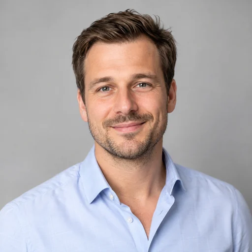
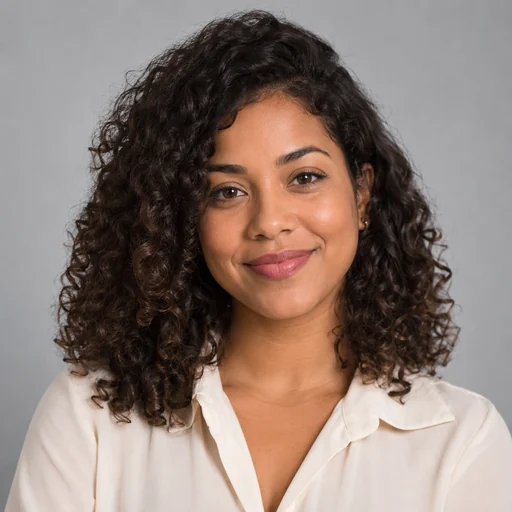

# Imágenes de demostración

12 imágenes creadas con la herramienta integrada `image_gen`: 10 retratos de personas completamente ficticias y 2 logos para las empresas demo. Convertidas a WebP RGB de 512 × 512 píxeles, calidad 86. Las nacionalidades son datos ficticios del seeder, no inferencias a partir de la apariencia.

Los retratos están en `accounts/static/accounts/demo/` y los logos en `companies/static/companies/demo/`. Los seeders reutilizan estas rutas y conservan las imágenes personalizadas. No se requieren servicios externos ni generación durante la carga de datos.

## Inventario

| Archivo | Vista previa |
|---|---|
| `camila.webp` |  |
| `alex.webp` |  |
| `sofia.webp` |  |
| `mateo.webp` |  |
| `aiko.webp` |  |
| `arjun.webp` |  |
| `amina.webp` |  |
| `claire.webp` |  |
| `omar.webp` |  |
| `jiwoo.webp` |  |
| `industrial-minera.webp` |  |
| `techindustrial.webp` |  |

## Prompts utilizados

### camila

```text
Use case: photorealistic-natural. Create one square professional profile avatar photograph for a fictional B2B platform demo user: Camila Rojas, Chilean woman age 32, dark shoulder-length hair, warm confident expression, simple business casual navy blouse. Head and shoulders centered with generous safe margin for circular cropping, soft neutral light gray studio background, natural diffused lighting, realistic skin texture. Single person, no text, no watermarks, no national symbols. Entirely fictional identity. Save a square image.
```

### alex

```text
Use case: photorealistic-natural. One square professional profile avatar photograph for fictional B2B demo user Alex Weber, German man age 38, short brown hair, light stubble, pale blue open collar shirt. Head and shoulders centered, safe margin for circular cropping, warm approachable expression, neutral light gray studio backdrop, soft natural diffused lighting, realistic skin texture, business casual. Single person, no text, no watermark, no national symbols. Entirely fictional identity. Match a consistent professional portrait series.
```

### sofia

```text
Use case: photorealistic-natural. One square professional profile avatar photograph for fictional B2B demo user Sofia Oliveira, Brazilian woman age 29, medium brown skin, natural curly dark hair, cream blouse. Head and shoulders centered, safe margin for circular cropping, warm approachable expression, neutral light gray studio backdrop, soft natural diffused lighting, realistic skin texture, business casual. Single person, no text, no watermark, no national symbols. Entirely fictional identity. Match a consistent professional portrait series.
```

### mateo

```text
Use case: photorealistic-natural. One square professional profile avatar photograph for fictional B2B demo user Mateo Garcia, Mexican man age 35, medium complexion, short dark hair, charcoal shirt. Head and shoulders centered, safe margin for circular cropping, warm approachable expression, neutral light gray studio backdrop, soft natural diffused lighting, realistic skin texture, business casual. Single person, no text, no watermark, no national symbols. Entirely fictional identity. Match a consistent professional portrait series.
```

### aiko

```text
Use case: photorealistic-natural. One square professional profile avatar photograph for fictional B2B demo user Aiko Tanaka, Japanese woman age 34, straight dark bob haircut, sage green blouse. Head and shoulders centered, safe margin for circular cropping, warm approachable expression, neutral light gray studio backdrop, soft natural diffused lighting, realistic skin texture, business casual. Single person, no text, no watermark, no national symbols. Entirely fictional identity. Match a consistent professional portrait series.
```

### arjun

```text
Use case: photorealistic-natural. One square professional profile avatar photograph for fictional B2B demo user Arjun Mehta, Indian man age 33, medium brown skin, short black hair, neatly trimmed beard, light blue shirt. Head and shoulders centered, safe margin for circular cropping, warm approachable expression, neutral light gray studio backdrop, soft natural diffused lighting, realistic skin texture, business casual. Single person, no text, no watermark, no national symbols. Entirely fictional identity. Match a consistent professional portrait series.
```

### amina

```text
Use case: photorealistic-natural. One square professional profile avatar photograph for fictional B2B demo user Amina Diallo, Senegalese woman age 36, dark skin, natural braided hair tied back, navy blazer. Head and shoulders centered, safe margin for circular cropping, warm approachable expression, neutral light gray studio backdrop, soft natural diffused lighting, realistic skin texture, business casual. Single person, no text, no watermark, no national symbols. Entirely fictional identity. Match a consistent professional portrait series.
```

### claire

```text
Use case: photorealistic-natural. One square professional profile avatar photograph for fictional B2B demo user Claire Martin, French woman age 40, fair skin, wavy brown hair, gray blazer. Head and shoulders centered, safe margin for circular cropping, warm approachable expression, neutral light gray studio backdrop, soft natural diffused lighting, realistic skin texture, business casual. Single person, no text, no watermark, no national symbols. Entirely fictional identity. Match a consistent professional portrait series.
```

### omar

```text
Use case: photorealistic-natural. One square professional profile avatar photograph for fictional B2B demo user Omar Hassan, Egyptian man age 37, olive complexion, short black hair, neat beard, beige shirt. Head and shoulders centered, safe margin for circular cropping, warm approachable expression, neutral light gray studio backdrop, soft natural diffused lighting, realistic skin texture, business casual. Single person, no text, no watermark, no national symbols. Entirely fictional identity. Match a consistent professional portrait series.
```

### jiwoo

```text
Use case: photorealistic-natural. One square professional profile avatar photograph for fictional B2B demo user Jiwoo Kim, South Korean woman age 30, shoulder length dark hair, charcoal blouse. Head and shoulders centered, safe margin for circular cropping, warm approachable expression, neutral light gray studio backdrop, soft natural diffused lighting, realistic skin texture, business casual. Single person, no text, no watermark, no national symbols. Entirely fictional identity. Match a consistent professional portrait series.
```

### industrial-minera

```text
Use case: logo-brand. Generate a polished standalone square corporate avatar logo for fictional B2B company Industrial Minera SpA. Symbol only, no text or letters. abstract angular mountain strata and precision engineering motif, copper and deep navy. Flat clean geometric brand mark, strong silhouette, large centered symbol with generous padding for circular avatar cropping, solid off-white background, no mockups, no shadows, no gradients, no watermark. This is a new fictional brand.
```

### techindustrial

```text
Use case: logo-brand. Generate a polished standalone square corporate avatar logo for fictional B2B company TechIndustrial GmbH. Symbol only, no text or letters. abstract precision waveform and industrial measurement motif, teal and deep navy. Flat clean geometric brand mark, strong silhouette, large centered symbol with generous padding for circular avatar cropping, solid off-white background, no mockups, no shadows, no gradients, no watermark. This is a new fictional brand.
```

## Ampliación de logos

Las marcas musicales ahora tienen diez logos adicionales asociados a sus nombres.
Este inventario conserva los retratos y las dos identidades iniciales; los nuevos
archivos y prompts están en [Logos de empresas](logos-empresas.md).
