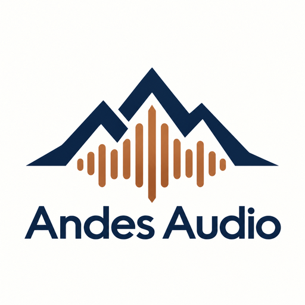
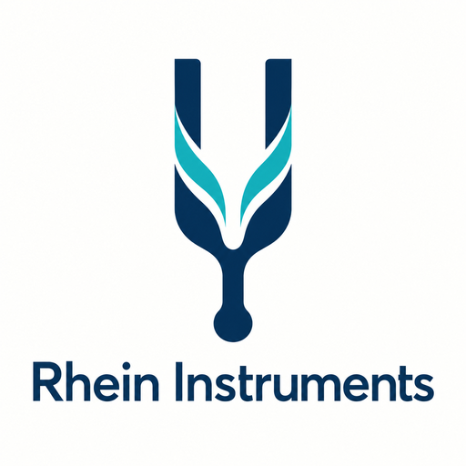
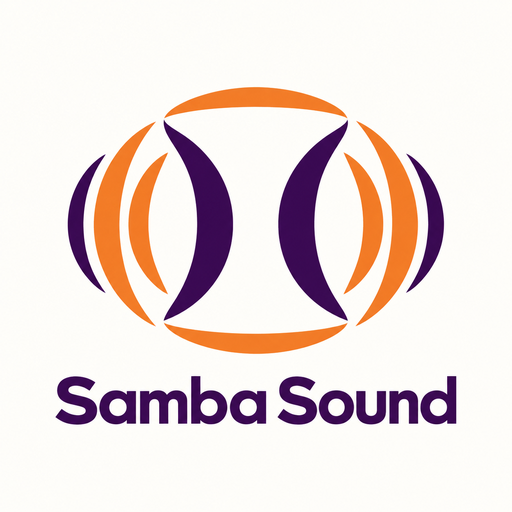
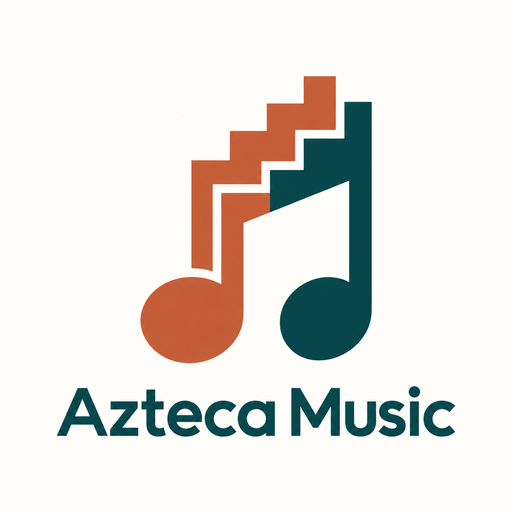
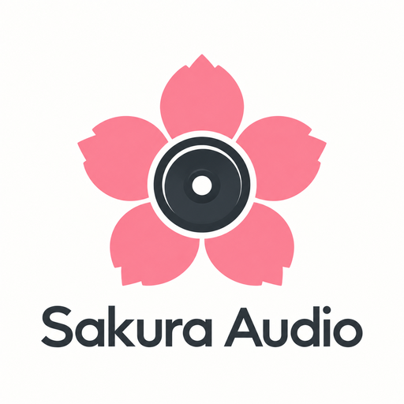
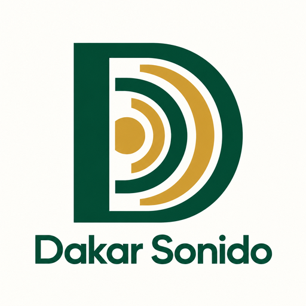
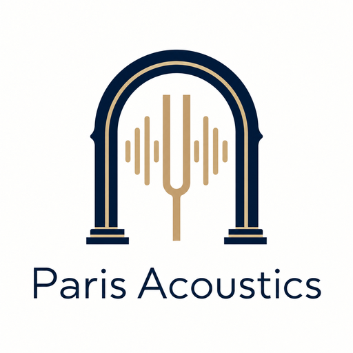
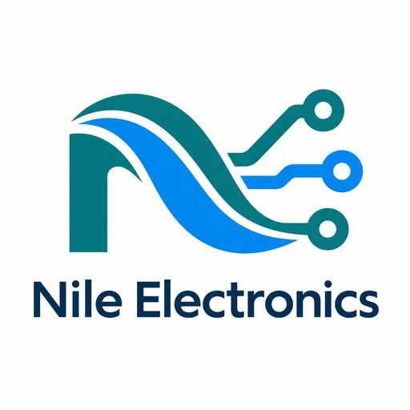
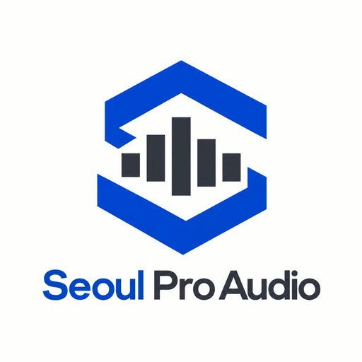

# Logos de empresas

Se crearon diez logos con la herramienta integrada `image_gen`, asociados a los nombres de las marcas musicales. Se guardaron en `companies/static/companies/demo/` como WebP RGB de 512 × 512 píxeles, con compresión sin pérdida. Las variantes `Demo NNN` comparten únicamente el logo de su propia marca.

Industrial Minera conserva su símbolo de montaña y minería; TechIndustrial conserva su símbolo de medición industrial. En total, las veinte empresas usan doce identidades. Los logos personalizados se conservan al volver a ejecutar `python manage.py seed_companies`.

## Identidades

| Marca | Concepto | Logo |
|---|---|---|
| Andes Audio | a geometric Andean mountain silhouette seamlessly integrated with a sound wave |  |
| Rhein Instruments | a graceful flowing river line shaped like a precision tuning fork |  |
| Samba Sound | a rhythmic abstract pair of sound wave arcs suggesting a percussion drum |  |
| Azteca Music | an original stepped geometric musical note inspired by architectural rhythm, with no borrowed sacred symbols |  |
| Sakura Audio | a minimal five petal cherry blossom with a subtle speaker cone at its center |  |
| Mumbai Stage | a modern stage proscenium with two minimal converging spotlight beams, forming an abstract M |  |
| Dakar Sonido | a bold abstract D made from resonant concentric sound arcs |  |
| Paris Acoustics | a refined architectural arch integrated with an acoustic wave or tuning fork, elegant and understated |  |
| Nile Electronics | a flowing river curve integrated into a simple precise electronic circuit trace with three nodes |  |
| Seoul Pro Audio | a clean angular S combined with a five-bar audio equalizer |  |

## Prompts utilizados

### Andes Audio

```text
Use case: logo-brand. Create one finished square corporate logo for the fictional music equipment company "Andes Audio". Identity concept: a geometric Andean mountain silhouette seamlessly integrated with a sound wave. Palette: deep navy and copper. Sophisticated flat geometric graphic, crisp clean shapes, visually distinctive and recognizable at small size. Center the brand symbol in the upper two thirds, with a clearly readable restrained sans serif wordmark "Andes Audio" below it. Spell the name exactly. Solid off-white background, generous clear margins for an avatar. No mockup, no scene, no photographic objects, no gradients, no 3D, no watermark, no extra text or slogans. Professional B2B music industry brand.
```

### Rhein Instruments

```text
Use case: logo-brand. Create one finished square corporate logo for the fictional music equipment company "Rhein Instruments". Identity concept: a graceful flowing river line shaped like a precision tuning fork. Palette: midnight blue and turquoise. Sophisticated flat geometric graphic, crisp clean shapes, visually distinctive and recognizable at small size. Center the brand symbol in the upper two thirds, with a clearly readable restrained sans serif wordmark "Rhein Instruments" below it. Spell the name exactly. Solid off-white background, generous clear margins for an avatar. No mockup, no scene, no photographic objects, no gradients, no 3D, no watermark, no extra text or slogans. Professional B2B music industry brand.
```

### Samba Sound

```text
Use case: logo-brand. Create one finished square corporate logo for the fictional music equipment company "Samba Sound". Identity concept: a rhythmic abstract pair of sound wave arcs suggesting a percussion drum. Palette: warm orange and deep purple. Sophisticated flat geometric graphic, crisp clean shapes, visually distinctive and recognizable at small size. Center the brand symbol in the upper two thirds, with a clearly readable restrained sans serif wordmark "Samba Sound" below it. Spell the name exactly. Solid off-white background, generous clear margins for an avatar. No mockup, no scene, no photographic objects, no gradients, no 3D, no watermark, no extra text or slogans. Professional B2B music industry brand.
```

### Azteca Music

```text
Use case: logo-brand. Create one finished square corporate logo for the fictional music equipment company "Azteca Music". Identity concept: an original stepped geometric musical note inspired by architectural rhythm, with no borrowed sacred symbols. Palette: terracotta and dark teal. Sophisticated flat geometric graphic, crisp clean shapes, visually distinctive and recognizable at small size. Center the brand symbol in the upper two thirds, with a clearly readable restrained sans serif wordmark "Azteca Music" below it. Spell the name exactly. Solid off-white background, generous clear margins for an avatar. No mockup, no scene, no photographic objects, no gradients, no 3D, no watermark, no extra text or slogans. Professional B2B music industry brand.
```

### Sakura Audio

```text
Use case: logo-brand. Create one finished square corporate logo for the fictional music equipment company "Sakura Audio". Identity concept: a minimal five petal cherry blossom with a subtle speaker cone at its center. Palette: cherry pink and charcoal. Sophisticated flat geometric graphic, crisp clean shapes, visually distinctive and recognizable at small size. Center the brand symbol in the upper two thirds, with a clearly readable restrained sans serif wordmark "Sakura Audio" below it. Spell the name exactly. Solid off-white background, generous clear margins for an avatar. No mockup, no scene, no photographic objects, no gradients, no 3D, no watermark, no extra text or slogans. Professional B2B music industry brand.
```

### Mumbai Stage

```text
Use case: logo-brand. Create one finished square corporate logo for the fictional music equipment company "Mumbai Stage". Identity concept: a modern stage proscenium with two minimal converging spotlight beams, forming an abstract M. Palette: saffron gold and ink navy. Sophisticated flat geometric graphic, crisp clean shapes, visually distinctive and recognizable at small size. Center the brand symbol in the upper two thirds, with a clearly readable restrained sans serif wordmark "Mumbai Stage" below it. Spell the name exactly. Solid off-white background, generous clear margins for an avatar. No mockup, no scene, no photographic objects, no gradients, no 3D, no watermark, no extra text or slogans. Professional B2B music industry brand.
```

### Dakar Sonido

```text
Use case: logo-brand. Create one finished square corporate logo for the fictional music equipment company "Dakar Sonido". Identity concept: a bold abstract D made from resonant concentric sound arcs. Palette: emerald green and warm gold. Sophisticated flat geometric graphic, crisp clean shapes, visually distinctive and recognizable at small size. Center the brand symbol in the upper two thirds, with a clearly readable restrained sans serif wordmark "Dakar Sonido" below it. Spell the name exactly. Solid off-white background, generous clear margins for an avatar. No mockup, no scene, no photographic objects, no gradients, no 3D, no watermark, no extra text or slogans. Professional B2B music industry brand.
```

### Paris Acoustics

```text
Use case: logo-brand. Create one finished square corporate logo for the fictional music equipment company "Paris Acoustics". Identity concept: a refined architectural arch integrated with an acoustic wave or tuning fork, elegant and understated. Palette: midnight blue and muted champagne gold. Sophisticated flat geometric graphic, crisp clean shapes, visually distinctive and recognizable at small size. Center the brand symbol in the upper two thirds, with a clearly readable restrained sans serif wordmark "Paris Acoustics" below it. Spell the name exactly. Solid off-white background, generous clear margins for an avatar. No mockup, no scene, no photographic objects, no gradients, no 3D, no watermark, no extra text or slogans. Professional B2B music industry brand.
```

### Nile Electronics

```text
Use case: logo-brand. Create one finished square corporate logo for the fictional music equipment company "Nile Electronics". Identity concept: a flowing river curve integrated into a simple precise electronic circuit trace with three nodes. Palette: teal and electric blue. Sophisticated flat geometric graphic, crisp clean shapes, visually distinctive and recognizable at small size. Center the brand symbol in the upper two thirds, with a clearly readable restrained sans serif wordmark "Nile Electronics" below it. Spell the name exactly. Solid off-white background, generous clear margins for an avatar. No mockup, no scene, no photographic objects, no gradients, no 3D, no watermark, no extra text or slogans. Professional B2B music industry brand.
```

### Seoul Pro Audio

```text
Use case: logo-brand. Create one finished square corporate logo for the fictional music equipment company "Seoul Pro Audio". Identity concept: a clean angular S combined with a five-bar audio equalizer. Palette: cobalt blue and graphite. Sophisticated flat geometric graphic, crisp clean shapes, visually distinctive and recognizable at small size. Center the brand symbol in the upper two thirds, with a clearly readable restrained sans serif wordmark "Seoul Pro Audio" below it. Spell the name exactly. Solid off-white background, generous clear margins for an avatar. No mockup, no scene, no photographic objects, no gradients, no 3D, no watermark, no extra text or slogans. Professional B2B music industry brand.
```
