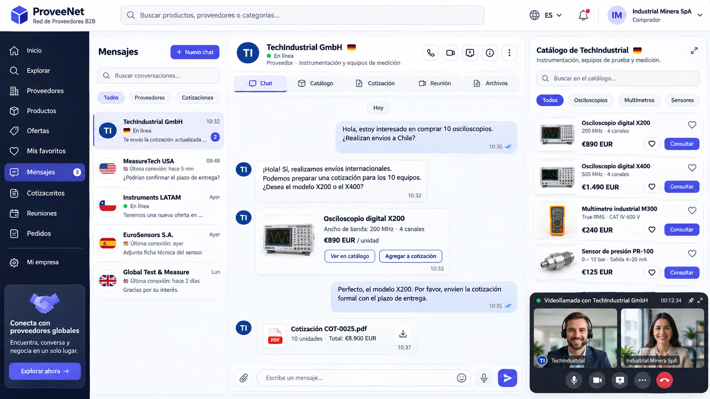

# ProveeNet

Plataforma B2B para conectar empresas compradoras y proveedoras. El proyecto
contempla catálogos de productos, relaciones comerciales, conversaciones,
cotizaciones y órdenes de compra.



Actualmente cuenta con la base del backend en Django: 29 modelos, migraciones
y datos de ejemplo organizados por aplicación. La página principal pública permite buscar proveedores por empresa o producto, país
y categoría. La API y las funciones en tiempo real están pendientes de implementación.

## Inicio rápido

Desde la raíz del proyecto, en PowerShell, con Python 3.13:

```powershell
python -m venv venv
.\venv\Scripts\Activate.ps1
python -m pip install -r requirements.txt
python manage.py migrate
python manage.py seed
python manage.py runserver
```

El servidor local queda disponible en `http://127.0.0.1:8000/`.
La página principal está en `/` y el administrador en `/admin/`.
Para acceder al administrador, crea una cuenta:

```powershell
python manage.py createsuperuser
```

## Organización

| Aplicación | Contenido |
|---|---|
| `app` | Parte pública |
| `accounts` | Usuarios y autenticación |
| `companies` | Empresas, países y miembros |
| `catalog` | Productos, categorías y ofertas |
| `social` | Favoritos, seguimientos y publicaciones |
| `messaging` | Conversaciones y mensajes |
| `quotations` | Solicitudes, cotizaciones y órdenes de compra |
| `collaboration` | Sesiones de catálogo y llamadas |
| `notifications` | Notificaciones e historial |

## Datos de ejemplo y pruebas

```powershell
python manage.py seed
python manage.py test accounts companies catalog social messaging quotations collaboration notifications app
```

El seeder puede repetirse sin duplicar registros. Los usuarios de demostración nuevos o sin contraseña reciben `ProveeNet2026!`.
Las contraseñas existentes se conservan. Los comandos individuales y los detalles
de instalación están en las especificaciones técnicas.

## Documentación

- [Especificación funcional y propuesta original](_docs/especificacion-funcional.md)
- [Especificaciones técnicas del proyecto](_docs/especificaciones-tecnicas.md)

La carga masiva incluye 100 usuarios ficticios de diez nacionalidades, 20 empresas
y más de 200 productos. Reutiliza los diez retratos WebP y los logos locales.
Ver [imágenes de demostración](_docs/imagenes-demo.md).


Para entrar con datos de ejemplo: usuario `demo_comprador` o `demo_proveedor`,
contraseña inicial `ProveeNet2026!` (solo desarrollo).

```powershell
python manage.py seed --scale 2
python manage.py seed --password "MiDemo2026!" --reset-passwords
```

`--scale` acepta valores de 1 a 10. El restablecimiento afecta únicamente a las
cuentas demo del seeder; no crea permisos de administrador.
Ver [volúmenes, credenciales y reglas de simulación](_docs/datos-simulados.md).

## Estilos de la página principal

La interfaz de `app` usa Tailwind CSS compilado localmente. El archivo generado
`app/static/app/css/site.css` está incluido: Django puede servir la página sin Node.
Para modificar los estilos o añadir clases en las plantillas:

```powershell
npm ci
npm run build:css
# Durante el desarrollo:
npm run watch:css
```

Los estilos fuente están en `app/static/app/css/input.css`; la plantilla principal,
en `app/templates/app/home.html`. Los filtros se procesan en el servidor y funcionan
sin JavaScript. El directorio muestra proveedores activos; `Ver productos` despliega
sus productos activos. Las fuentes web tienen alternativas locales.

El catálogo demo reutiliza [20 imágenes genéricas WebP](_docs/imagenes-productos.md),
dos por categoría, para ilustrar los productos sin depender de servicios externos.
